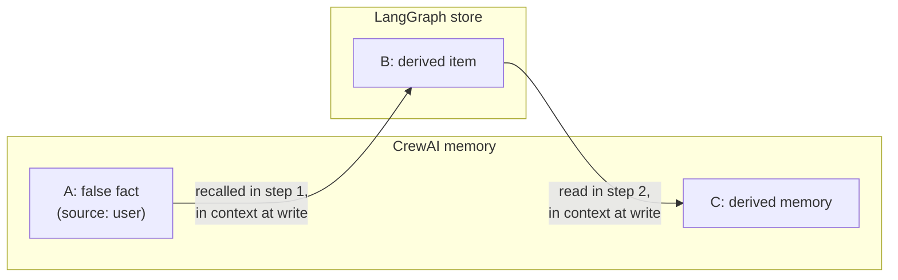

# dod

**Context management decides what goes into the context. We record what came out because of it.**

Agents with long-lived memory pick up false beliefs: a wrong fact from a user, a stale tool result, a poisoned document. Each time one is retrieved into context, the agent can write new memories derived from it, and those spread to further writes, sometimes in other stores. When a bad output finally surfaces, nothing records which memory caused it or what else it contaminated, so today the only reliable fix is wiping memory and losing everything the agent learned. `dod` records the one edge that can't be reconstructed after the fact, so you can find and remove only what's contaminated.

## How it works

At every write, `dod` records which retrieved items were in the model's context at that moment. Each write gets a row in an append-only SQLite ledger: write ID, content hash, timestamp, store, agent and session IDs, source (`user`, `tool`, `document`, `agent_inference`), and its parents, the `(store, record_id)` items that were in context, each tagged `in_prompt` or `retrieved_in_scope`.

Everything else is a query over that graph:

- `trace(ledger, store, record_id)` walks backward from a bad output to the writes it came from.
- `blast_radius(ledger, store, record_id)` walks forward to everything derived from an item, across stores.
- `ledger.quarantine(items)` marks items as contaminated (reversible with `ledger.release`); instrumented stores stop returning them, so they can't become parents of new writes.
- `excise(ledger, store, record_id)` quarantines (default) or, with `mode="delete"`, deletes an item and its whole blast radius across stores, leaving everything else untouched. `dry_run=True` shows the plan first.



`trace(C)` reaches `A` through `B`; `blast_radius(A)` returns `B` and `C`. One `agent_task_scope` links retrievals and writes across every instrumented store, so the edge from a CrewAI recall to a LangGraph put is recorded like any other.

## Install

Not on PyPI yet. From a clone:

```bash
pip install -e ".[crewai]"      # CrewAI memory (crewai==1.15.22)
pip install -e ".[langgraph]"   # LangGraph Store (langgraph==1.2.14)
pip install -e ".[anthropic]"   # Anthropic memory tool (anthropic==1.12.1)
pip install -e ".[crewai,langgraph]"   # both, for the quickstart
pip install -e ".[otel]"        # OpenTelemetry export (opentelemetry-api/sdk==1.45.1)
```

The core library has no dependencies; integrations are optional extras.

## Quickstart

One `Capture` instruments a CrewAI `Memory` and a LangGraph `InMemoryStore`. A false fact is saved, two scoped steps derive new items from it across both stores, then the last one is traced back and everything derived from the false fact is quarantined. `toy_embed` is a stand-in embedder so the example runs offline; pass any embedding callable or crewai embedder config.

```python
from crewai.memory.unified_memory import Memory
from langgraph.store.memory import InMemoryStore

from dod.capture import Capture
from dod.integrations import crewai, langgraph
from dod.ledger import Ledger
from dod.query import blast_radius, trace
from dod.scope import agent_task_scope

ledger = Ledger(os.path.join(workdir, "ledger.db"))
cap = Capture(ledger)
memory = crewai.instrument(
    Memory(storage=os.path.join(workdir, "crewai"), embedder=toy_embed), cap
)
store = langgraph.instrument(InMemoryStore(), cap)
ns = ("users", "ana")

def remember(text, source=None):
    return memory.remember(text, scope="/", categories=[], importance=0.5,
                           source=source)

# A false fact gets saved.
with agent_task_scope("assistant", "onboarding"):
    root = remember("Ana is allergic to peanuts", source="user")

# Step 1: recall from CrewAI, write to LangGraph.
with agent_task_scope("assistant", "meal-plan"):
    memory.recall("what is Ana allergic to", depth="shallow")
    store.put(ns, "meal-plan", {"text": "no peanut dishes this week"})

# Step 2: read from LangGraph, write to CrewAI.
with agent_task_scope("assistant", "groceries"):
    store.get(ns, "meal-plan")
    bad = remember("Removed peanut butter from the grocery list")

# The bad output traces back to the false fact, across both stores.
t = trace(ledger, "crewai", bad.id)
print("trace roots:", [(w.store, w.write_id) for w in t.roots])
print("path:", [(e.parent_store, e.parent_record_id) for e in t.edges])

# Everything derived from the false fact.
b = blast_radius(ledger, "crewai", root.id)
print("blast radius:", b.store_counts)
affected = sorted({item for items in b.bindings.values() for item in items})

# Quarantine (reversible): instrumented CrewAI recall stops returning them.
ledger.quarantine(affected, reason="false allergy", actor="oncall")
with agent_task_scope("assistant", "after"):
    after = memory.recall("what is Ana allergic to", depth="shallow")
print("recall after quarantine:", [m.record.content for m in after])
```

Run it with `python examples/quickstart.py`. `tests/test_quickstart.py` runs the same file and checks this block still matches it.

Inside a crew, call `crewai.install_task_scopes()` once instead of entering scopes by hand: every task then runs in `agent_task_scope(agent.id, task.id)`.

## OpenTelemetry

`OTelObserver` adds each captured write to the traces you already collect: a `dod.memory_write` event on the current span (or a short span of that name if none is active), plus `dod.memory_bind` and `dod.memory_delete`.

```python
from opentelemetry import trace

from dod.capture import Capture
from dod.export.otel import OTelObserver

cap = Capture(ledger, observers=[OTelObserver()])
tracer = trace.get_tracer("my-agent")

with tracer.start_as_current_span("agent-step"):
    ...  # instrumented recalls and writes add dod.memory_write events here
```

Attributes are IDs, hashes and tags only (`dod.write.id`, `dod.write.content_hash`, `dod.parents.store`/`record_id`/`tag`, ...; see `dod/export/otel.py`), never memory content, and never `gen_ai.*` names. The observer only calls the OpenTelemetry API: where the data goes is decided by your own SDK and exporter configuration, and without one nothing is sent. Observers run after the ledger commit; one that raises is logged and never breaks capture.

## Guarantees

- **Content-free ledger.** The ledger stores IDs, content hashes, edges, and metadata only. Memory content stays in your stores. (`reason` and `actor` on quarantine are stored as you pass them; keep content out of them.)
- **Append-only.** Writes, parents, bindings, deletions (tombstones), and quarantine actions are only ever inserted; schema triggers reject updates, deletes, and `INSERT OR REPLACE`. Quarantine and release are new rows, so every action stays auditable.
- **No network calls home.** The library makes no telemetry or network calls. (Framework packages may have their own telemetry; the example turns off crewai's.)
- **p99 < 1 ms capture overhead per write**, asserted by benchmarks in the test suite (`pytest -q tests/test_*_perf.py -s`).

What it does **not** do:

- **No automated detection of bad memories.** You identify the bad output; `dod` traces it to its origin and shows what it reached.
- Quarantine is enforced by the instrumented stores (CrewAI recall, LangGraph `get`/`search`, memory tool `view`); reads that bypass them see quarantined items.
- Writes that bypass an instrumented store (direct database inserts, uninstrumented tools) are not captured.

## Status

Supported:

- **CrewAI 1.15.22** `Memory`: `recall`, `remember`, `remember_many`, `update`, `forget`, `reset`, `reset_all`, and consolidation on save. Rewrites are recorded as compactions; every deleted record gets an append-only tombstone, so `trace` and `blast_radius` report what was deleted and why.
- **LangGraph Store** (langgraph 1.2.14, langgraph-checkpoint 4.2.0): `get`, `search`, `put`, `delete`, and async variants, on stores that keep `BaseStore`'s default routing (such as `InMemoryStore`).
- **Anthropic memory tool** (anthropic 1.12.1, `memory_20250818`): `view`, `create`, `str_replace`, `insert`, `delete`, `rename`, and `clear_all_memory`, on `BetaAbstractMemoryTool`/`BetaAsyncAbstractMemoryTool` subclasses that keep the default `call` (such as `BetaLocalFilesystemMemoryTool`). A viewed file is an `in_prompt` parent; the record ID is the memory path.
- `trace`, `blast_radius`, quarantine/release, and `excise` (quarantine or delete), across all three stores through one ledger.
- OpenTelemetry export of every write, bind and deletion as `dod.*` span events (opentelemetry-api 1.45.1).

Next: regenerate (rewrite derived items without the bad parent) and more integrations (LangGraph agents, Pydantic AI, an MCP gateway).

## Demo

A support agent keeps memory in CrewAI and a LangGraph store, with 12 correct items. One customer message gets saved as a "policy update" (refunds within 90 days; the real policy is 30), and scripted steps derive four items from it across both stores. The last one is a wrong reply to a customer. The demo traces that reply back to its roots, shows the blast radius per store, quarantines only that subgraph, and re-runs the reply. Then it compares the result with wiping everything.

```bash
pip install -e ".[crewai,langgraph]"
python examples/false_memory_demo.py
```

It runs in seconds, offline, with no LLM calls (the agents are fixed rules), and prints the same output every time. It ends with:

```
== 6. Wipe everything vs. excise ==================================
Wipe both stores:        loses all 17 items, including 12 correct ones.
Roll back to the root:   loses 3 correct items learned after it.
Excise its subgraph:     removes 5, keeps all 12 correct items.

Summary: excised 5 items, preserved 12, stores touched: crewai, langgraph.
```

`tests/test_demo.py` runs the demo and checks these numbers.
