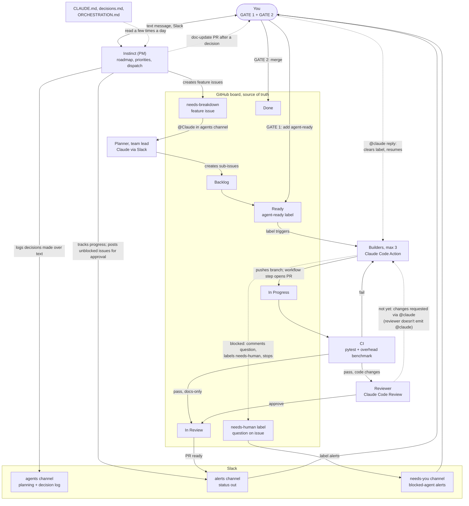
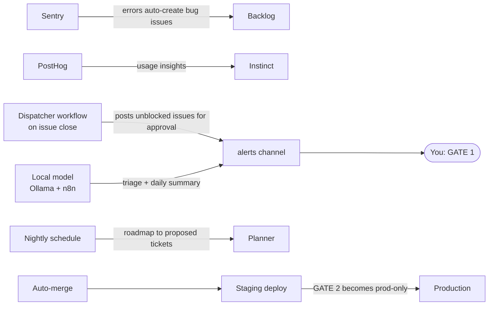

# Agent Orchestration

Everything flows through GitHub. Everything reports to Slack. Instinct runs the project day to day; the human keeps both gates: adding `agent-ready` and merging.

## Layers
- **Instinct (PM)**: the top orchestration layer. Owns the roadmap and priorities, creates feature-level issues labeled `needs-breakdown`, tracks progress, and dispatches unblocked work. The human talks to it mainly by text message and in Slack.
- **Planner (Claude, team lead)**: breaks `needs-breakdown` features into technical sub-issues.
- **Builders (Claude Code Action)**: implement sub-issues once the human adds `agent-ready`.
- **Human**: direction, both gates, and answers to `needs-human` questions.

## System flow (MVP)

## Future inputs (post-MVP)

## How agents are triggered
- **`@Claude` in `#agents`**: planning and breakdowns (the planner).
- **`@claude` on a GitHub issue or PR**: builder fixes and follow-ups.
- **Labels**:
  - `needs-breakdown` routes to the planner.
  - `needs-human` routes to the human (alert in `#needs-you`).
  - `agent-ready` is added by the human only. It starts a builder.

## Handoff rules
1. Instinct hands off through a feature issue labeled `needs-breakdown`, stating: goal, why, priority, and definition of done.
2. The planner reads it once and creates the technical sub-issues.
3. Any question goes on the issue, not Slack. At most one clarifying round between planner and Instinct.
4. Direction or design questions go to the human: comment the question on the issue and label it `needs-human`.
5. No open-ended agent discussions in Slack.

## Instinct's operating rules
- Reads `CLAUDE.md`, `docs/decisions.md`, and `docs/ORCHESTRATION.md` a few times a day.
- Requests doc updates only after a decision is made, always as PRs the human approves.
- Logs any decision made over text message in `#agents`.
- Dispatches unblocked work by posting it for approval; never adds `agent-ready` or merges.

## Local Claude Code instances
Two Claude Code instances run on the human's machine, outside GitHub Actions:
- **Coding**: hands-on repo work the Action can't or shouldn't do, e.g. `.github/workflows/` changes (the GitHub App can't push them) and process PRs.
- **Strategy**: strategy sections of `CLAUDE.md`, `docs/decisions.md`, and private notes kept outside the repo.

Both follow the same flow: branch, PR, human merge.

## Needs-human flow
1. A builder that's blocked (ambiguous criteria, unsettled design decision, conflict with CLAUDE.md, missing dependency or permission) comments its question on the issue, adds `needs-human`, and stops. No PR: the PR-opening step skips `needs-human` issues.
2. The label posts an alert to `#needs-you` in Slack.
3. The human answers with an `@claude` comment. `claude.yml` removes `needs-human` before Claude starts, and Claude resumes from the answer.

## PR-opening step
The Claude Code Action's built-in prompt makes Claude post a "Create PR" link instead of opening a PR, even with `gh pr create` allowed. So `claude.yml` has a final step, **Open PR for Claude's branch**, that runs after Claude on issue events:
- Finds the newest `claude/issue-<N>-*` branch; skips if there's no branch, no new commits, or a PR already exists.
- Opens the PR with the issue title and `Closes #N`, so merging closes the issue.
- Authenticates with the `PAT_TOKEN` secret (classic PAT, `repo` + `project` scopes). PRs opened with `GITHUB_TOKEN` don't trigger CI or Claude Code Review. The same token drives the board automation.

## Review → fix loop
The reviewer ends its summary with one `BLOCKING_FILE: <path>` line per blocking finding and a final `BLOCKING: <count>` line. `scripts/review-auto-fix.sh` (run from the base branch's copy, because that step holds `PAT_TOKEN`) reads them:
- `BLOCKING: 0`: nothing to do.
- Above 0: posts `@claude fix the blocking items in the latest review`, up to 3 rounds per PR, then adds `needs-human`.
- Every blocking finding under `.github/workflows/`: adds `needs-human` straight away, since agent runs can't push workflow changes.

## Keeping PRs current
After every push to `main`, `scripts/update-branches.sh` updates each open PR that is behind:
1. `gh pr update-branch` (GitHub's server-side merge).
2. If GitHub reports a conflict but a local merge is clean, it merges in a temporary worktree and pushes with `PAT_TOKEN`. GitHub's merge ignores `.gitattributes`, so this is what applies the `union` driver on `docs/decisions.md` (parallel PRs all append there).
3. A real conflict gets a comment listing the files plus `needs-human`; the label is removed automatically once the conflict is gone.

## CI
- `test` installs every integration (`[dev,crewai,langgraph,anthropic,otel,mcp,pydantic_ai,postgres]`, with a pgvector Postgres service) so integration, cross-store, quickstart and demo tests run; `test-core` runs with `[dev]` only to keep the core dependency-free.
- Capture-path benchmarks assert p99 < 1 ms (median of 3 rounds). A few worst-case benchmarks sit near 1 ms on slow dev machines and pass on CI's faster runners (#52 tracks the structural fix).

## Responsibility chart

| Actor | Responsibility | Trigger | Output |
|---|---|---|---|
| You | Direction, GATE 1 (add `agent-ready`), GATE 2 (merge), answer `needs-human` questions, approve doc-update PRs | Your call; `#alerts` and `#needs-you` alerts | Direction to Instinct, labels, `@claude` answers, merges |
| Instinct (PM) | Roadmap and priorities; feature issues; progress tracking; dispatch unblocked work; log text decisions; request doc updates after decisions | Text message or Slack from you; doc reads a few times a day; issue closes | `needs-breakdown` issues, `#alerts` posts, `#agents` decision log, doc-update PRs |
| Planner, team lead (Claude via Slack) | Break `needs-breakdown` features into technical sub-issues | `@Claude` in `#agents` | Sub-issues in Backlog with priority + size |
| Builders (Claude Code Action) | Code, tests, fixes; push a `claude/issue-N-*` branch. When blocked: ask on the issue, label `needs-human`, stop | `agent-ready` label; `@claude` on an issue or PR | Branch; PR opened by the PR-opening step. Or a question + `needs-human` |
| Reviewer (Claude Code Review, `claude-code-review.yml`) | Strict review: tests, edge cases, capture overhead < 1 ms, CLAUDE.md conventions | Called from `ci.yml` after tests pass; skipped for docs-only PRs (all files Markdown or under `docs/`) | Inline comments + summary ending in `BLOCKING_FILE:` / `BLOCKING:` lines, which drive the auto-fix loop |
| CI (GitHub Actions) | `test` (all integrations) and `test-core` (no integrations); capture overhead < 1 ms | PR opened or updated | Pass / fail |
| Auto-update (`update-branches.yml`) | Keep open PRs current with `main`; hand real conflicts to the human | Every push to `main` | Merge commits on PR branches, or a conflict comment + `needs-human` |
| Local Claude Code: coding | Workflow changes and other repo work outside the Action | Your prompt | Branch + PR |
| Local Claude Code: strategy | Strategy sections of CLAUDE.md, decisions log, private notes | Your prompt | Doc edits, PRs |
| GitHub board | Track state of all work | `project-board.yml` (agent-ready label -> Ready, Claude starts -> In progress) + built-in workflows | Card movement |
| Slack | `#agents` planning and decision log, `#alerts` status, `#needs-you` blocked agents | GitHub app events, Instinct, planner | Alerts to you |
| `#needs-you` (Slack) | Tell you an agent is blocked | `needs-human` label added | Alert linking the issue |

## Setup checklist

### MVP
- [x] CLAUDE.md (stack, conventions, test commands, workflow, no strategy in code or commits)
- [x] Issue template
- [x] Labels: `agent-ready`, `bug`, `feature`, `needs-human`, `needs-breakdown`
- [x] Branch protection on `main`: ruleset `protecting_main` (active): PR required, no force-push or deletion, linear history. Not yet: required CI check (no checks listed) and 1 approving review (count is 0).
- [x] Claude subscription token (`CLAUDE_CODE_OAUTH_TOKEN`): watch Pro usage limits.
- [x] Claude Code GitHub Action (`/install-github-app`)
- [x] Claude Code Review workflow on the repo (replaces Greptile): runs after CI passes, skips docs-only PRs
- [x] CI: pytest + p99 < 1 ms capture benchmarks, with every integration installed (`test`) and without (`test-core`)
- [x] Needs-human flow: ask on issue, label, stop; `@claude` reply clears label (`claude.yml`, CLAUDE.md)
- [x] Reviewer → builder loop: `BLOCKING:` lines trigger an automatic `@claude` fix request (3 rounds, then `needs-human`)
- [x] Auto-update behind PRs after every push to `main`, with a local-merge fallback for `.gitattributes` drivers
- [x] `#needs-you` Slack alert on `needs-human`
- [x] Slack: Claude Tag + GitHub app; agents, alerts, needs-you channels
- [x] GitHub Mobile app
- [x] Docs backed up to a Claude.ai Project: decisions, research, CLAUDE.md
- [ ] `PAT_TOKEN` expires in 90 days (set 2026-09-27, so ~2026-12-26); renew before it lapses or PRs stop opening.
- [ ] Instinct's GitHub account in `allowed_bots` (`claude.yml`)

### Post-MVP
- [ ] Dispatcher workflow: on issue close, find open issues whose "Depends on" issues are all closed and post them to #alerts as ready to approve, respecting max 3 In progress. Auto-labeling `agent-ready` is a flag, off for now. (Instinct dispatches in the meantime.)
- [ ] Scheduled planner Action
- [ ] Weekly summary Action (progress + spend)
- [ ] Auto-merge + staging
- [ ] Ollama + n8n local model
- [ ] PyPI publishing workflow
- [ ] Vercel, Supabase, Sentry, PostHog
